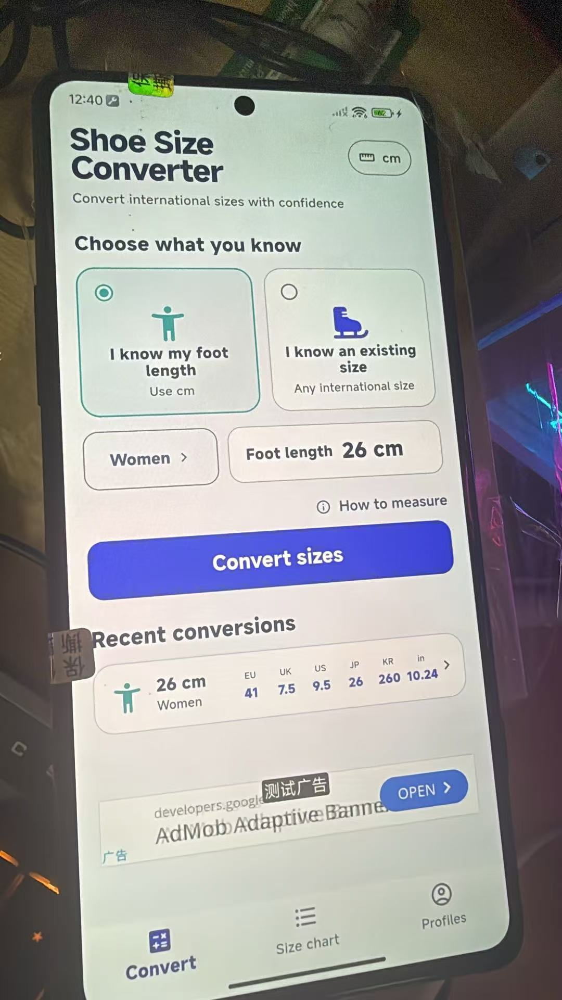
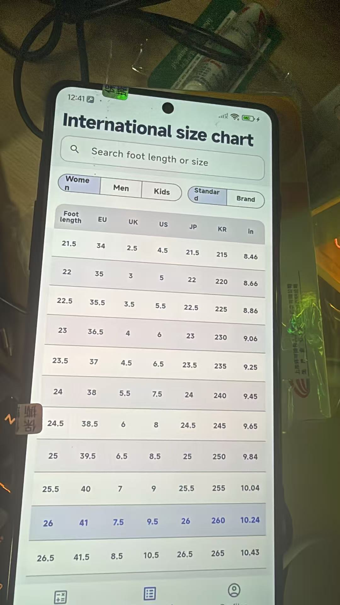

# dd-openSource

[中文](#中文) · [English](#english)

An open-source project collection maintained by [274335390](https://github.com/274335390).

## 中文

`dd-openSource` 是一个持续维护的开源项目集合。每个项目位于 `projects/` 下，拥有独立的代码、说明文档、数据声明与发布节奏。

### 项目列表

| 项目 | 用途 | 技术栈 | 状态 |
| --- | --- | --- | --- |
| [StrideMetric](projects/stride-metric/) | 离线国际鞋码换算、品牌官方尺码参考、个人脚部档案与多语言尺码对照 | Flutter、Dart | 积极开发 |

<p align="center">
  
  &nbsp;
  
</p>

### 仓库结构

```text
dd-openSource/
├─ projects/
│  └─ stride-metric/       # StrideMetric 产品、客户端、领域包、数据与文档
└─ README.md
```

### 许可说明

各项目独立声明许可证。数据、品牌标志、截图、标准资料及第三方资源的使用条款可能不同于源代码许可证，复用前请阅读对应项目中的数据与许可声明。

## English

`dd-openSource` is a maintained collection of open-source projects. Each project lives under `projects/` and has its own source code, documentation, data notices, and release lifecycle.

### Projects

| Project | Purpose | Stack | Status |
| --- | --- | --- | --- |
| [StrideMetric](projects/stride-metric/) | Offline international shoe-size conversion, official brand references, personal foot profiles, and multilingual size charts | Flutter, Dart | Active development |

<p align="center">
  
  &nbsp;
  
</p>

### Repository layout

```text
dd-openSource/
├─ projects/
│  └─ stride-metric/       # Product, clients, domain package, data, and docs
└─ README.md
```

### Licensing

Each project declares its own license. Data, brand marks, screenshots, standards, and third-party assets may have terms different from the source-code license. Read the notices inside each project before reuse.
