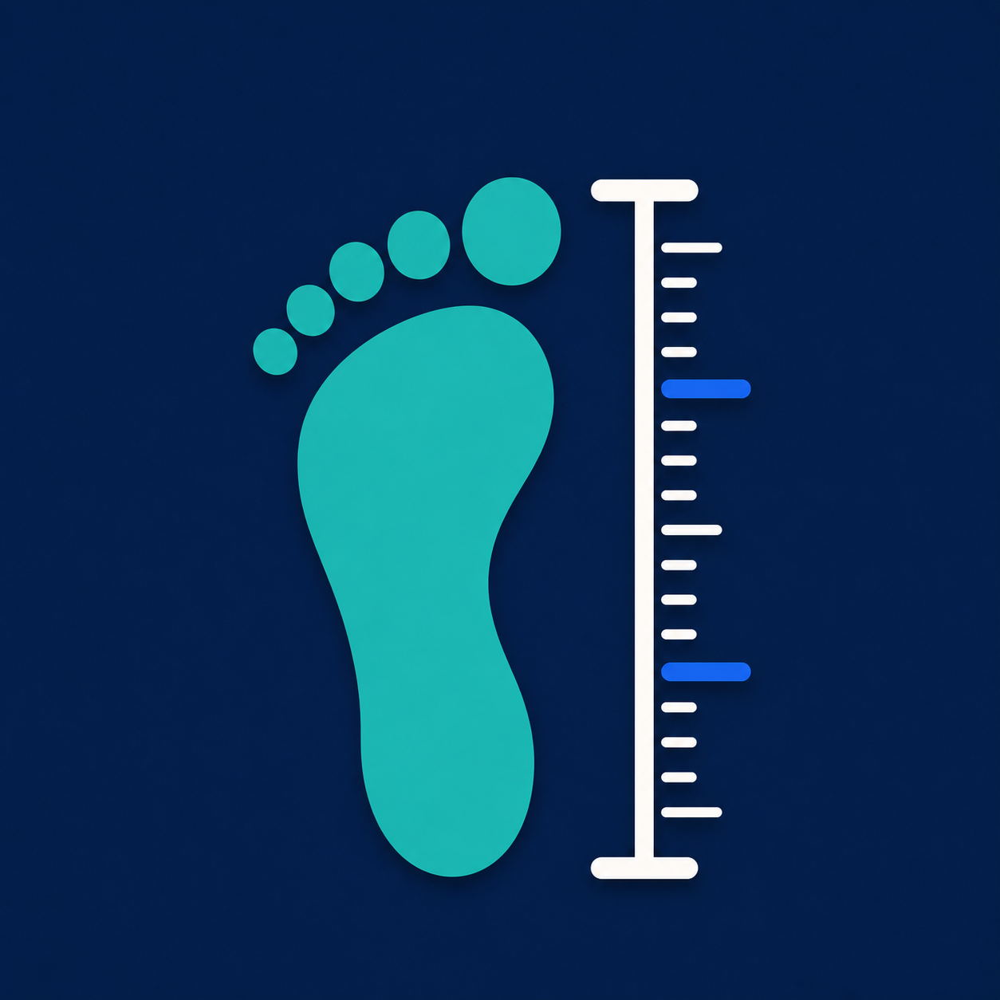
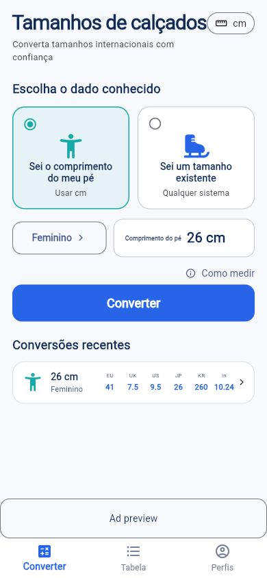
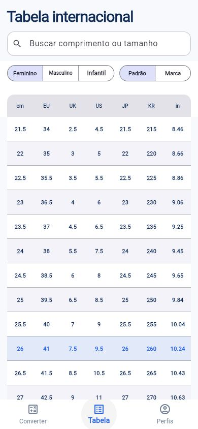

# StrideMetric

[中文](#中文) · [English](#english)

<p align="center">
  
</p>

<p align="center"><strong>Measure once. Fit everywhere.</strong></p>

## 中文

StrideMetric（中文显示名：鞋码换算）是一款面向 Android、iOS 和 Web 的离线国际鞋码换算应用。它将通用换算标准、品牌官方尺码表和个人脚部档案分开处理，让用户清楚每个结果的来源和含义。

### 应用展示

<p align="center">
  
  &nbsp;
  
  &nbsp;
  
</p>

### 核心功能

- 按脚长或现有鞋码进行 EU、UK、US、JP、KR 与英寸换算
- 女款、男款和童款独立数据流
- 标准对照表与品牌官方尺码表
- 本地个人档案、左右脚长度、脚宽及最近换算记录
- 毫米、厘米和英寸显示偏好
- 浅色与深色主题
- 离线优先，换算核心不依赖网络
- 13 种界面语言：English、Türkçe、Deutsch、Español、Français、Italiano、Português (Brasil)、日本語、한국어、简体中文、Русский、Nederlands、हिन्दी
- Android 端 AdMob 横幅广告和开屏广告；开屏最多等待 2.5 秒，未及时加载则直接进入首页且本次不补弹

### 目录说明

| 路径 | 作用 |
| --- | --- |
| [`apps/stride_metric/`](apps/stride_metric/) | Flutter 客户端，包含页面、国际化、主题、广告接入及 Android/iOS/Web 工程 |
| [`packages/size_domain/`](packages/size_domain/) | 不依赖 Flutter 的纯 Dart 领域引擎，负责长度单位、鞋码和服装尺码推荐模型 |
| [`data/`](data/) | 鞋码、服装和市场相关结构化数据、来源登记及数据审计 |
| [`scripts/`](scripts/) | 数据结构、来源和完整性校验脚本 |
| [`docs/`](docs/) | 产品研究、UX 规格、系统架构、国际化、数据授权及竞品审计 |
| [`DATA_NOTICE.md`](DATA_NOTICE.md) | 数据、品牌和第三方资源的使用边界 |

### 快速运行

```bash
cd projects/stride-metric/apps/stride_metric
flutter pub get
flutter run
```

连接 Android 手机后，可先运行 `flutter devices` 查看设备，再用 `flutter run -d <设备ID>` 指定设备。Web 预览可运行：

```bash
flutter run -d chrome
```

### 验证

```bash
cd projects/stride-metric/apps/stride_metric
flutter analyze
flutter test

cd ../../
node scripts/validate-data.mjs
```

### 数据原则

1. 内部统一以毫米保存脚长。
2. 保留品牌发布的原始尺码标签，不用通用公式补齐品牌未公布值。
3. 严格区分实测脚长与鞋标上的 CM/JP 标签。
4. 数据集保留来源、市场、适用人群、版本与验证状态。
5. 仓库和应用不分发未经许可的标准全文或扫描件。

商业使用或重新分发数据前，请阅读 [`DATA_NOTICE.md`](DATA_NOTICE.md)。

### 产品标识与许可

- 产品名：**StrideMetric**
- 中文显示名：**鞋码换算**
- Android application ID：`com.stridemetric.shoe`
- iOS bundle identifier：`com.stridemetric.shoe`
- 源代码许可证：[MIT](LICENSE)

## English

StrideMetric is an offline international shoe-size conversion app for Android, iOS, and Web. It keeps generic standards, brand-published charts, and personal foot profiles separate so users can understand what each result represents.

### Screenshots

<p align="center">
  
  &nbsp;
  
  &nbsp;
  
</p>

### Features

- Convert by measured foot length or an existing EU, UK, US, JP, KR, or inch size
- Separate women, men, and children flows
- Generic reference tables and brand-published size charts
- Local profiles with left/right foot length, width, and recent conversions
- Millimetre, centimetre, and inch display preferences
- Light and dark themes
- Offline-first conversion engine
- 13 UI languages: English, Türkçe, Deutsch, Español, Français, Italiano, Português (Brasil), 日本語, 한국어, 简体中文, Русский, Nederlands, and हिन्दी
- Android AdMob banner and app-open ads; cold start waits at most 2.5 seconds and never shows a late ad after entering the home screen

### Repository components

| Path | Purpose |
| --- | --- |
| [`apps/stride_metric/`](apps/stride_metric/) | Flutter client with screens, localization, themes, ads, and Android/iOS/Web projects |
| [`packages/size_domain/`](packages/size_domain/) | Framework-independent Dart domain engine for units, shoe conversion, and clothing recommendations |
| [`data/`](data/) | Structured shoe, clothing, and market data with source registries and audits |
| [`scripts/`](scripts/) | Dataset schema, provenance, and integrity validation |
| [`docs/`](docs/) | Product research, UX specs, architecture, internationalization, licensing, and competitor audits |
| [`DATA_NOTICE.md`](DATA_NOTICE.md) | Usage boundaries for datasets, brands, and third-party resources |

### Quick start

```bash
cd projects/stride-metric/apps/stride_metric
flutter pub get
flutter run
```

For a connected Android phone, use `flutter devices` and then `flutter run -d <device-id>`. For Web:

```bash
flutter run -d chrome
```

### Verification

```bash
cd projects/stride-metric/apps/stride_metric
flutter analyze
flutter test

cd ../../
node scripts/validate-data.mjs
```

### Data principles

1. Store canonical foot length internally in millimetres.
2. Preserve brand-published labels instead of filling missing values with a universal formula.
3. Keep measured foot length separate from the CM/JP value printed on a shoe label.
4. Retain source, market, audience, version, and verification status with every dataset.
5. Never ship unlicensed standards or page scans in the app or repository.

Read [`DATA_NOTICE.md`](DATA_NOTICE.md) before commercial use or redistribution.

### Identity and license

- Product name: **StrideMetric**
- Chinese display name: **鞋码换算**
- Android application ID: `com.stridemetric.shoe`
- iOS bundle identifier: `com.stridemetric.shoe`
- Source license: [MIT](LICENSE)
