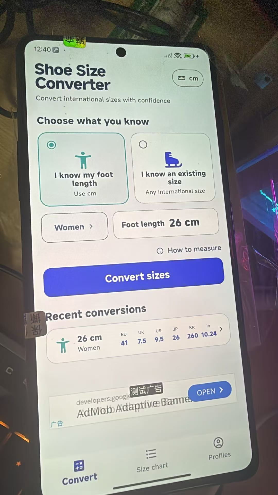
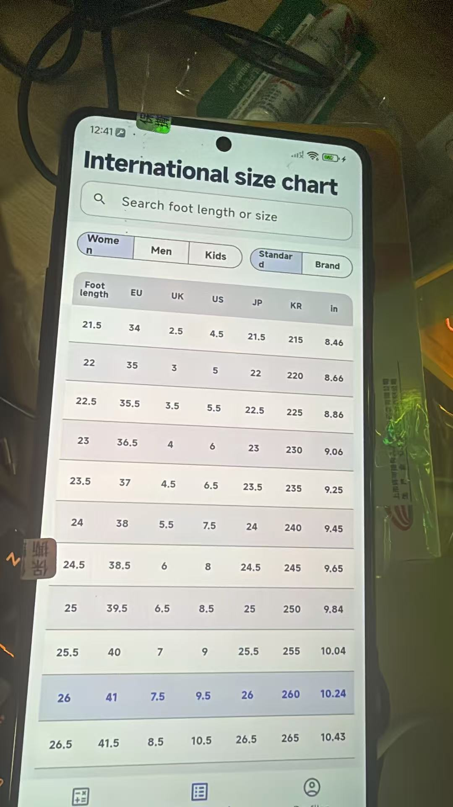

# StrideMetric Flutter App

[中文](#中文) · [English](#english)

## 中文

这里是 StrideMetric 的 Flutter 客户端，面向 Android、iOS 和 Web。产品总览、数据原则和完整仓库结构请查看[项目 README](../../README.md)。

<p align="center">
  
  &nbsp;
  
</p>

### 客户端包含什么

| 路径 | 用途 |
| --- | --- |
| `lib/screens/` | 换算、尺码对照、换算结果和档案页面 |
| `lib/core/` | 应用状态、数据模型和鞋码目录加载 |
| `lib/l10n/` | 13 种语言的界面文案与区域设置 |
| `lib/ads/` | AdMob 横幅和开屏广告生命周期 |
| `lib/ui/` | 主题、通用组件和响应式布局 |
| `assets/data/` | 客户端离线标准表与品牌表 |
| `assets/brands/` | 品牌标志资源 |
| `assets/branding/` | 应用图标和品牌资源 |
| `test/` | 单元、组件、数据和多语言紧凑屏幕测试 |
| `tool/` | Android 发布构建及 Web 预览辅助脚本 |

### 环境要求

- Flutter SDK（以 `pubspec.lock` 对应版本为准）
- Android Studio 与 Android SDK；构建 iOS 时需要 macOS 与 Xcode
- Android 真机需打开开发者选项和 USB 调试

### 运行

```powershell
flutter pub get
flutter devices
flutter run -d <设备ID>
```

Web 预览：

```powershell
flutter run -d chrome
```

或先构建，再使用仓库中的本地静态服务器：

```powershell
flutter build web --debug
node .\tool\serve_web_preview.mjs
```

### 广告配置

项目不会把生产广告 ID 直接提交到公开仓库。复制 `.env.example` 或使用 `--dart-define`/本地 Android 属性配置自己的值。Debug 构建使用 Google 测试广告单元，避免误点真实广告。

详细配置、开源分发注意事项和启动策略见 [`docs/ADVERTISING.md`](docs/ADVERTISING.md)。

当前开屏策略：

- 冷启动最多等待 2.5 秒
- 广告及时就绪则展示
- 超时立即进入首页，本次启动不再补弹
- 普通前后台切换不会突然补弹开屏广告

### 检查与测试

```powershell
flutter analyze
flutter test
flutter build apk --debug
```

## English

This directory contains the StrideMetric Flutter client for Android, iOS, and Web. See the [project README](../../README.md) for the product overview, data principles, and full repository map.

<p align="center">
  
  &nbsp;
  
</p>

### Client components

| Path | Purpose |
| --- | --- |
| `lib/screens/` | Converter, size chart, result, and profile screens |
| `lib/core/` | App state, models, and shoe catalog loading |
| `lib/l10n/` | UI copy and locale handling for 13 languages |
| `lib/ads/` | AdMob banner and app-open ad lifecycle |
| `lib/ui/` | Themes, shared widgets, and responsive layouts |
| `assets/data/` | Offline generic and brand datasets used by the client |
| `assets/brands/` | Brand logo assets |
| `assets/branding/` | App icon and product branding |
| `test/` | Unit, widget, data, and compact-screen localization tests |
| `tool/` | Android release-build and Web-preview helpers |

### Requirements

- Flutter SDK compatible with `pubspec.lock`
- Android Studio and Android SDK; macOS and Xcode for iOS builds
- Developer options and USB debugging enabled for an Android device

### Run

```powershell
flutter pub get
flutter devices
flutter run -d <device-id>
```

For Web:

```powershell
flutter run -d chrome
```

Or build and serve the static preview:

```powershell
flutter build web --debug
node .\tool\serve_web_preview.mjs
```

### Advertising configuration

Production ad IDs are not committed to the public repository. Copy `.env.example` or provide your own values through `--dart-define`/local Android properties. Debug builds use Google's test ad units to prevent invalid production traffic.

See [`docs/ADVERTISING.md`](docs/ADVERTISING.md) for setup, open-source distribution guidance, and the startup policy.

Current app-open policy:

- Wait at most 2.5 seconds during cold start
- Show the ad only when it becomes ready in time
- Enter the home screen on timeout and never show a late ad for that launch
- Do not unexpectedly show an app-open ad on ordinary foreground transitions

### Quality checks

```powershell
flutter analyze
flutter test
flutter build apk --debug
```
